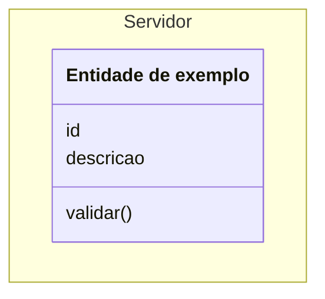
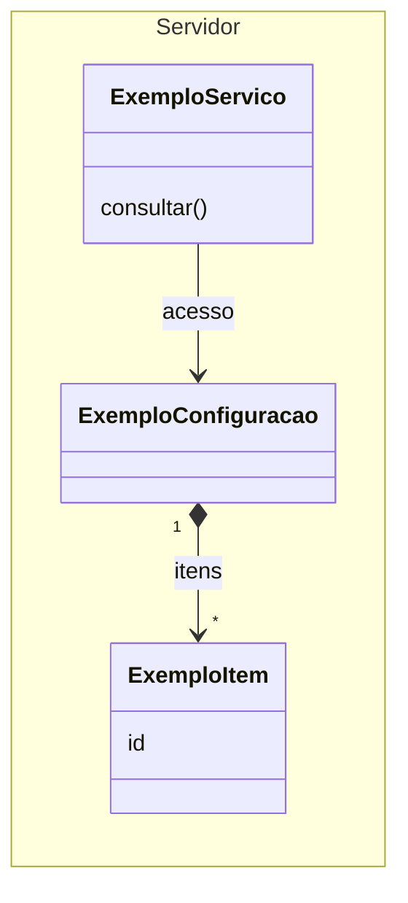

# Guia de edição do modelo DDD em Mermaid

A equipe mantém um único modelo, construído progressivamente a partir da base
apresentada pelo professor. Cada integrante pode propor os conceitos necessários
à sua feature e discutir sua integração com o restante do modelo.

O serviço de processamento do servidor foi renomeado para **NotificaçãoService**
(`NotificacaoService` na fonte), com o propósito de ser compartilhado pela equipe
para os diferentes tipos de notificação. A renomeação preserva os atributos,
métodos e relações existentes. As operações atuais tratam lembretes; o
processamento dos demais tipos ainda será validado com a equipe.

## 1. Qual arquivo usar

| Arquivo | Uso |
| --- | --- |
| [modelo-ddd.mmd](modelo-ddd.mmd) | Fonte oficial do diagrama. Contém somente código Mermaid, incluindo configuração e comentários. |
| [GUIA-MERMAID.md](GUIA-MERMAID.md) | Este guia: instruções e exemplos isolados. |
| [ddd-notificacoes-incremental.png](ddd-notificacoes-incremental.png) | Imagem exportada para visualização rápida. |
| [exportar-modelo-ddd.py](../../scripts/exportar-modelo-ddd.py) | Exporta o Mermaid e acrescenta a legenda abaixo do diagrama no PNG. |

Edite o `.mmd` para modificar o modelo. O PNG precisa ser atualizado depois das
mudanças aprovadas; editar a imagem não modifica o código. O arquivo `.mmd` pode
ser aberto em qualquer editor de texto. No GitHub, ele pode ser consultado como
texto; use o Mermaid Live para renderizar o código completo.

## 2. Abrir no Mermaid Live

1. Abra [Mermaid Live Editor](https://mermaid.live/).
2. Se aparecer uma oferta de outro produto, escolha **Stay on mermaid.live**.
3. Abra `modelo-ddd.mmd` no editor de texto ou no GitHub e copie todo o conteúdo.
4. No painel **Code** do Mermaid Live, selecione todo o exemplo inicial e
   substitua-o pelo conteúdo copiado.
5. Inclua o cabeçalho entre `---`, o `classDiagram` e todas as linhas seguintes.
   O arquivo já está pronto: não acrescente delimitadores Markdown como
   ` ```mermaid ` ou ` ``` `.
6. Confira o desenho no painel de visualização. Use os controles de zoom e
   **Reset view** para navegar pelo diagrama.

Alterar o código no Mermaid Live não atualiza o repositório automaticamente.
Depois de editar, copie todo o código de volta para `modelo-ddd.mmd` na sua branch.
Uma URL compartilhada do editor também não substitui o arquivo versionado no Git.

## 3. Entender as partes do arquivo

- O cabeçalho `config`, entre `---`, define aparência e espaçamento.
- `classDiagram` define o tipo de diagrama; `direction LR` organiza-o da
  esquerda para a direita.
- `namespace Cliente` reúne os módulos do cliente, como configuração e histórico.
- `namespace Servidor` reúne os objetos e serviços do servidor.
- As linhas depois das declarações representam as relações entre os elementos.
- `style` e `note` acrescentam destaques e anotações.
- Linhas iniciadas por `%%` são comentários e não criam relações no desenho.

Uma caixa escrita com `class` não é automaticamente uma entidade de DDD. Ela
pode representar um módulo, uma entidade, um objeto de valor, um serviço ou uma
coleção, conforme o conceito discutido pela equipe. Entidades precisam de
identidade e continuidade; objetos de valor são definidos por seus valores.

As associações indicam acesso ou referência. Elas não determinam a sequência de
requisições nem garantem que um cenário esteja implementado. As operações
representadas são conceituais: seus nomes não fixam endpoints ou tipos da aplicação.

Os comentários sobre propostas pendentes não significam que essas propostas
estejam aprovadas ou desenhadas. Uma decisão discutida precisa ser revisada
antes de entrar no modelo.

## 4. Adicionar uma classe, atributos e métodos

Este exemplo é independente e pode ser colado sozinho no Mermaid Live. Ele
ensina a sintaxe; não adiciona uma entidade real ao projeto.



- `ExemploEntidade` é o identificador usado nas relações. Escolha identificadores
  únicos, sem espaços; por exemplo, `MinhaEntidade` ou `MinhaEntidadeCliente`.
- O texto entre colchetes e aspas é o nome visível. Ele pode ter espaços e acentos.
- `id` e `descricao` são atributos; uma linha com parênteses, como `validar()`,
  representa uma operação.
- Para ampliar a classe, acrescente seus atributos e operações dentro das chaves.

Para incluir uma classe no modelo principal, copie somente sua declaração para
o `namespace` adequado que já existe no `.mmd`. Mantenha apenas um `classDiagram`
e o cabeçalho de configuração original. Evite declarar duas vezes o mesmo elemento.

## 5. Adicionar relações e cardinalidades

Este segundo exemplo também é independente. As classes são fictícias e servem
somente para demonstrar uma configuração com itens e um serviço com acesso a ela.



No modelo principal, declare os elementos primeiro e acrescente a relação na
seção de relações correspondente. Use seus identificadores, não seus nomes visíveis.

### Legenda do modelo


A legenda também faz parte do próprio PNG, para acompanhar a imagem compartilhada.
Ela explica a notação; não acrescenta classes ou relações ao modelo.

| Sintaxe | Significado |
| --- | --- |
| `A --> B` | Associação com navegação de A para B: A acessa ou referencia B. |
| `B <-- A` | O mesmo acesso de A para B; a escrita invertida pode ajudar a organizar o layout. |
| `A -- B` | Ligação sem uma direção de navegação indicada. |
| `A *--> B` | Composição com navegação: B faz parte de A; o losango preenchido fica em A. |
| `A o--> B` | Agregação com navegação: A agrupa B; o losango vazio fica em A. |
| `A --> B : origem` | Associação com um rótulo que explica seu significado. |
| `A "1" --> "*" B` | Cada A associa-se a zero ou mais B; cada B associa-se a um A. |
| Ligação pontilhada de anotação | Conecta uma nota explicativa ao elemento; não acrescenta uma associação de domínio. |

As multiplicidades aparecem entre aspas junto aos extremos: `"1"` significa um,
`"0..1"` significa zero ou um, `"*"` significa zero ou mais e `"1..*"` significa
um ou mais. Escolha-as a partir das regras da feature, não da posição das caixas.

O losango fica no extremo do todo ou agrupador. O asterisco tem dois usos distintos:
em `*--` é o comando Mermaid para desenhar composição; em `"*"` junto ao extremo
é uma multiplicidade. Uma seta representa acesso ou referência, sem definir
sequência de chamadas, navegação de telas ou autorização.

O modelo original também contém extremos combinados, como a relação entre
`Student` e `Enrolment`. Preserve sua notação enquanto a equipe não revisar seu
significado. Agregação na notação UML não é sinônimo de agregado em DDD: um agregado
DDD delimita objetos cujas regras de consistência precisam ser protegidas conjuntamente.

Antes de escolher composição, discuta o pertencimento e o ciclo de vida das
partes. Uma relação útil para acessar dados não exige necessariamente composição.

## 6. Ajustar o espaço sem alterar o modelo

O Mermaid calcula as posições. No cabeçalho existente:

- Aumente `nodeSpacing` para ampliar o espaço entre elementos.
- Aumente `rankSpacing` para ampliar o espaço entre camadas do desenho.
- Ajuste `fontSize` com cuidado para manter nomes e operações legíveis.

O cabeçalho usa `markdownAutoWrap: false` para manter as operações em uma linha
e evitar sobreposição entre métodos quando a assinatura é longa. Preserve essa
opção ao exportar ou colar a fonte completa no Mermaid Live.

Faça ajustes pequenos e observe o resultado. Preserve a indentação do YAML e os
nomes das configurações. Para resolver falta de espaço, ajuste a apresentação;
qualquer remoção de relação precisa de uma justificativa conceitual própria.

## 7. Conferir a feature antes de propor a mudança

Escolha um cenário e verifique:

1. Quais informações ele exige e onde estão representadas ou serão obtidas.
2. Quais objetos ou serviços precisam acessar essas informações.
3. Quais relações e multiplicidades permitem esse acesso.
4. Quais regras e mudanças de estado precisam ser definidas.
5. Como representar o caso de sucesso e as rejeições ou falhas previstas.

Para um lembrete de notas pendentes, por exemplo, precisamos considerar o
agendamento, a turma, o professor destinatário, as pendências e o resultado do
processamento. Listar esses dados não aprova automaticamente novas classes:
primeiro discuta com a equipe como cada informação deve ser representada.

Um caminho de setas não prova que o cenário funciona. A análise do diagrama é
conceitual; os testes da futura implementação precisam comprovar suas regras.
O acompanhamento dos 25 cenários de lembretes está em
[COBERTURA-CENARIOS.md](COBERTURA-CENARIOS.md), separando regras representadas,
lacunas e resultados de descoberta dos testes.
Esses cenários e suas marcações orientam a avaliação de completude do DDD desta
feature; a cada incremento, revise a cobertura conforme o critério registrado
na matriz. `//ok DDD (regra central)` não significa cobertura integral do cenário.
Quando outra equipe ainda não disponibiliza uma dependência, combine seu contrato
e os dados necessários para um mock/stub. Não trate esse dado simulado como uma
funcionalidade já implementada no projeto.

### Telas iniciais dos cenários GUI

A funcionalidade é utilizada por um único professor, com suas turmas disponíveis,
sem autenticação ou controle de acesso entre professores. Com aprovação do
responsável, os 12 cenários GUI começam explicitamente com o professor Paulo
Borba na tela correspondente, sem precondições de usuário ou senha:

- **Turmas:** visualização do histórico e configuração inicial da quantidade,
  datas e horários. No segundo caso, a turma 2026.2 de ESS está disponível e a
  ação de acessar Configuração de lembretes permanece no cenário.
- **Histórico de notificações:** consulta de detalhes históricos, filtragem e
  visualização de falha. A filtragem começa sem filtros aplicados; os cenários
  de detalhes e falha mantêm a ação de selecionar a tentativa para abrir seus detalhes.
- **Configuração de lembretes:** os sete casos de edição e rejeição começam na
  configuração da turma 2026.2 de ESS, preservando seu contexto de seleção.

A tela de cada cenário está registrada na matriz de COBERTURA-CENARIOS.md.
A adequação altera somente a precondição inicial dos 11 GUI que ainda exigiam
autenticação; os demais dados, ações e resultados são preservados. Não modifica
o modelo, o PNG ou os cenários de serviço.

### Prazo acadêmico da turma e rejeição de criação

`Class` passa a representar `prazoAcademico`, utilizado pela configuração dos
lembretes daquela turma. Ano e semestre não substituem essa informação. O prazo
não existe no código atual do servidor ou nos tipos do cliente; este incremento
acrescenta o conceito ao modelo, sem implementar seu cadastro na aplicação.

`Class.prazoEncerrado(instanteAtual)` retorna verdadeiro somente quando o instante
recebido é posterior ao prazo. A consulta não modifica dados, consulta o relógio
ou envia email. A igualdade com o prazo retorna falso; as demais validações da
configuração continuam necessárias.

`Services.configurarLembretes(turma, quantidade, lembretesPropostos)` acessa a turma
por `Classes` e consulta o relógio
do servidor uma vez. O prazo da mesma `Class` e o instante obtido são fornecidos
às operações de configuração e reagendamento. O professor não informa o instante
atual. O procedimento de cadastro do prazo continua fora deste incremento.

Se a proposta incluir um novo lembrete e o prazo já estiver encerrado, o serviço
rejeita a criação com o motivo **Prazo acadêmico encerrado**, antes de aplicar a
proposta. Preserva a turma, o prazo, a configuração, os lembretes enviados e o
histórico. Não cria o lembrete, não solicita email e não registra tentativa de envio.
Essa regra não acrescenta restrições a propostas sem novos lembretes.

| Situação | Resultado esperado no modelo |
| --- | --- |
| Instante atual anterior ao prazo | `prazoEncerrado` retorna falso; continuam necessárias as outras validações. |
| Instante atual exatamente igual ao prazo | Retorna falso, sem alterar dados. |
| Prazo 31/08/2026 às 23:59, criação solicitada em 01/09/2026 às 08:00 | Retorna verdadeiro; rejeitar a criação com o motivo definido, preservando o enviado existente e o histórico. |

O último percurso representa a regra central do cenário service **Bloqueio de
criação de novo lembrete após o prazo acadêmico**. O bloqueio durante o processamento
é detalhado a seguir; a transição para Cancelado continua pendente.

### Bloqueio por prazo antes de cada tentativa

`NotificaçãoService.processar(Lembrete)` coordena a verificação do prazo tanto na
primeira tentativa quanto nos reenvios que passam por essa operação:

1. Consultar `jaFoiEnviado()`; se verdadeiro, encerrar como já previsto.
2. Acessar a turma correspondente por `Classes` e obter uma vez o instante atual
   consultando o relógio do servidor.
3. Antes de solicitar email, consultar `Class.prazoEncerrado(instanteAtual)`.
4. Se verdadeiro, encerrar e informar **Prazo acadêmico encerrado** como resultado
   do processamento, sem solicitar email, registrar tentativa ou alterar os dados.
5. Se falso, continuar com as demais verificações necessárias ao envio.

O bloqueio preserva a turma, o prazo, a configuração, o identificador, a data, o
horário e o estado do lembrete, além de todas as notificações anteriores. Não
marca o lembrete como Enviado. Um Enviado continua protegido pela primeira
verificação, mesmo quando o prazo já encerrou.

A explicação é um resultado do serviço, não uma falha de envio de email. Ela não
é armazenada em um novo atributo do lembrete nem cria uma notificação de tentativa.
Não são acrescentados `motivoCancelamento`, `proximoReenvioEm`, operações ou relações.

| Contexto | Resultado esperado no modelo |
| --- | --- |
| Prazo 31/08/2026 às 23:59 e reenvio processado em 01/09/2026 às 00:00, com três falhas anteriores | Bloquear antes de EmailSender, informar Prazo acadêmico encerrado e preservar as três tentativas e o estado anterior do lembrete. |
| Primeira tentativa processada após o prazo | Aplicar o mesmo bloqueio sem email, tentativa ou alteração dos dados. |
| Instante atual anterior ou exatamente igual ao prazo | A consulta retorna falso; continuar com as outras verificações, sem presumir envio permitido. |
| Lembrete já Enviado é processado novamente após o prazo | Encerrar na primeira verificação, preservando o Enviado e seu histórico. |

O cenário **Interrupção dos reenvios após o prazo acadêmico** fica **parcial**:
o bloqueio e a preservação das tentativas estão descritos, mas ainda faltam a
transição para Cancelado, a preservação do motivo e o controle que encerra os
reenvios programados. Esses resultados não são garantidos por retornar uma mensagem
nem por `remove(Lembrete)`. A marcação `//ok` depende de resolver essas lacunas.

### Localização dos lembretes por agendamento

`ConfiguracaoLembretes.buscarLembretesPara(data, horario)` retorna uma lista dos
lembretes com exatamente aquela data e horário, restrita à configuração consultada.
É uma consulta: preserva objetos, estados e histórico, sem criar lembrete ou
solicitar email. A lista pode estar vazia ou conter vários lembretes; não foi
definida uma regra de exclusividade de data e horário. A busca não filtra estados
nem unifica `Não enviado` com `Agendado`.

`NotificaçãoService.processarAgendados(turma, data, horario)` é a entrada conceitual
para uma solicitação por turma e agendamento. Pelas associações existentes com
`Classes`, suas turmas e configurações, o serviço acessa a configuração da turma
indicada e realiza a consulta. Não é necessário acrescentar relações ao diagrama.

| Resultado da busca | Coordenação esperada |
| --- | --- |
| Nenhum lembrete corresponde à turma, data e horário | Rejeitar a solicitação por inexistência do lembrete agendado; preservar turma, prazo, configuração, lembretes e histórico, sem solicitar email ou registrar tentativa. |
| Um ou vários lembretes correspondem | Encaminhar cada um a `processar(Lembrete)`; a correspondência não dispensa as condições de processamento nem obriga envio. |
| Um dos correspondentes já está Enviado | O bloqueio existente de `processar` preserva esse lembrete e seu histórico, sem outra tentativa. |
| Outra turma possui lembrete na mesma data e horário | Esse lembrete não participa da consulta da turma solicitada. |

Os parâmetros identificam o agendamento solicitado, não o momento atual: uma
solicitação atrasada ainda pode referenciar o agendamento original. A busca não
consulta o relógio para substituir esses parâmetros. A entrada não cria um
agendador automático; seu disparo, a seleção de vencidos, os reenvios e a
concorrência continuam pendentes.

A lista vazia representa a regra central do cenário service **Bloqueio de envio
de lembrete não agendado**. Os dois bloqueios de reprocessamento de enviados
permanecem representados. Este incremento não acrescenta Professor, autenticação
ou RBAC. O nome do destinatário e a turma no registro são detalhados na consulta
de falha abaixo; o endereço de email foi posteriormente representado pela
configuração `NotificacaoService.emailProfessor`, descrita adiante.

### Consulta da configuração de lembretes

`Services.consultarConfiguracaoLembretes(turma)` coordena a leitura da configuração
da turma selecionada. `Classes.buscar(turma)` localiza a `Class` indicada e
`Class.obterConfiguracaoLembretes()` devolve sua configuração associada.
`ConfiguracaoLembretes.listar()` retorna todos os lembretes dessa configuração.

O percurso utiliza as relações existentes entre Services, Classes, Class,
ConfiguracaoLembretes e Lembrete. A consulta devolve os identificadores, datas,
horários e estados dos lembretes, junto do `prazoAcademico` da mesma turma.
A quantidade é calculada pelo total da lista, incluindo os Enviados, sem novo
atributo permanente. Sem lembretes, a lista é vazia e a quantidade é zero.

Essa leitura preserva o estado registrado e as demais turmas. Não aplica
atualizações, consulta o relógio, envia email ou processa lembretes. Pode ser usada
para apresentar a configuração antes da edição e o conjunto salvo depois de
aceitar ou rejeitar uma proposta, conforme os oito cenários GUI de configuração.

Os quatro métodos ficam visíveis nas respectivas classes do servidor. Não são
acrescentados atributos ou relações; cliente, Email Service, Interface, os demais
métodos e os passos Gherkin permanecem inalterados. Os parâmetros e retornos de
`configurarLembretes` foram detalhados no incremento descrito a seguir.

### Atualização completa da configuração de lembretes

`Services.configurarLembretes(turma, quantidade, lembretesPropostos)` continua
sendo a entrada conceitual da aplicação.
Em `ConfiguracaoLembretes`, a operação
`atualizar(quantidade, lembretesPropostos, instanteAtual, prazoAcademico)` representa a validação
do conjunto final pretendido antes de aplicar qualquer alteração.

`lembretesPropostos` são os dados de edição, não uma nova entidade nem lembretes que já
foram alterados. A quantidade informada deve corresponder ao total final,
incluindo os enviados que serão preservados; ela não é um novo atributo permanente.

`instanteAtual` é a data e o horário que o serviço obtém consultando o relógio do
servidor uma vez por atualização. O professor não informa esse argumento, e a
configuração não o guarda como atributo. Ele é utilizado apenas para comparar
os agendamentos novos ou alterados com o momento da operação. `reagendar` recebe
o mesmo contexto temporal; a operação recebe o valor, não uma função de relógio.

Novos lembretes precisam de data e horário. Agendamentos novos ou alterados não
podem estar no passado nem após o prazo recebido. Os enviados devem continuar
presentes e inalterados; suas datas antigas não são rejeitadas como se fossem
novos agendamentos. Alterações em lembretes existentes preservam seus identificadores.

A operação valida o conjunto antes de aplicar as mudanças, preservando as regras
de `add`, `remove` e `reagendar`. Uma rejeição mantém toda a configuração anterior
intacta; não modifica outras turmas nem os registros históricos. Essa regra ainda
precisará ser implementada e garantida na gravação em armazenamento.

### Entrada e resultado de salvar a configuração

O método `Services.configurarLembretes(turma, quantidade, lembretesPropostos)`
recebe a turma selecionada, a quantidade e os dados do conjunto final pretendido.
A turma é localizada por `Classes.buscar(turma)` e sua configuração é obtida por
`Class.obterConfiguracaoLembretes()`. O serviço fornece o instante obtido do
relógio e o prazo da mesma turma para coordenar `atualizar`.

O retorno `String`, visível na assinatura do método, contém a confirmação ou
o motivo da rejeição descrito pelos cenários:

| Resultado | Mensagem |
| --- | --- |
| Proposta válida aplicada integralmente | Configuração salva com sucesso |
| Quantidade incompatível ou data/horário obrigatório ausente | Selecione exatamente N datas e horários |
| Agendamento posterior ao prazo | Data posterior ao prazo acadêmico |
| Alteração de lembrete Enviado | Lembretes enviados não podem ser alterados |
| Agendamento anterior ao instante atual | Não é possível agendar lembretes em datas anteriores à data atual |

N corresponde à quantidade solicitada; no cenário com o terceiro agendamento
sem data e horário, a mensagem é Selecione exatamente 3 datas e horários.
O bloqueio existente de criação após o prazo continua retornando Prazo acadêmico
encerrado antes de aplicar a proposta.

Uma rejeição mantém toda a configuração anterior, os identificadores, os estados,
o prazo e o histórico. O sucesso preserva os Enviados, as demais turmas e o histórico.
Salvar não solicita email ou processamento de lembretes. A consulta existente
da configuração permite apresentar os dados salvos depois do resultado.
O incremento mantém atributos, relações, demais métodos e passos Gherkin.

Exemplos para percorrer conceitualmente:

| Situação proposta | Resultado esperado no domínio |
| --- | --- |
| Duas datas válidas e quantidade dois | Aceitar a configuração completa. |
| Quantidade três com apenas duas datas preenchidas | Rejeitar; preservar a configuração anterior. |
| Um novo agendamento passado ou após o prazo | Rejeitar; não aplicar parcialmente as outras mudanças. |
| Reduzir três lembretes para dois, mantendo o enviado | Aceitar a remoção do não enviado e preservar os demais. |
| Alterar ou excluir um enviado | Rejeitar; preservar o conjunto anterior. |
| Reagendar um não enviado dentro dos limites | Preservar seu id e o isolamento entre turmas. |

Esses exemplos cobrem regras de domínio presentes em cenários GUI. Não comprovam
navegação, mensagens, persistência ou testes executáveis aprovados. Autenticação e
RBAC não fazem parte do escopo acordado. O prazo pertence a `Class`; o contrato
concreto do relógio, os estados ainda indefinidos, o envio das notificações, o
processamento automático e a concorrência continuam pendentes.

### Responsabilidades na identificação das notas pendentes

O modelo mantém as notas dos alunos vinculadas às suas matrículas, no caminho
Class, Enrolment e Evaluation. Foram aprovados
`Class.identificarPendencias(instanteAtual)` e `Enrolment.buscarNota(avaliacao)`,
seguidos de `Enrolment.listarAvaliacoes()` e `Evaluation.dataAvaliacao`.
A consulta na Class utiliza as matrículas; as notas individuais continuam
representadas sob Enrolment, pelas relações existentes com Evaluation.

Conforme a opção A confirmada pelo responsável, cada matrícula já contém os
registros das avaliações, mesmo antes de o professor cadastrar as notas.
`grade` vazio significa nota ainda não cadastrada; zero, inclusive 0,0, é uma nota
válida. `listarAvaliacoes()` inclui os registros sem nota, e `dataAvaliacao`
informa a data em que a avaliação ocorreu ou está prevista no cenário.

`Class.identificarPendencias(instanteAtual)` consulta as avaliações de cada
matrícula, exclui as futuras e consulta `buscarNota(avaliacao)` nas já realizadas.
Apenas nota vazia em avaliação realizada gera uma pendência do aluno naquela
avaliação. O resultado fica restrito às matrículas da turma consultada.

Durante `NotificacaoService.processar(Lembrete)`, após os bloqueios de Enviado e
prazo, o serviço consulta a Class já localizada por Classes e chama a identificação
de pendências antes de solicitar email. O instante atual é o mesmo já obtido pelo
serviço. A identificação fica no fluxo interno de processamento dos lembretes,
sem acrescentar uma operação em Services ou exigir uma tela para o professor.

No cenário consultado em 25/08/2026 às 09:00, apenas João gera pendência na prova
realizada em 20/08/2026 às 14:00. Maria possui zero nessa prova e não gera
pendência. O projeto previsto para 28/08/2026 às 14:00 é futuro e fica fora da
verificação para ambos. Nenhuma outra pendência é devolvida.

A identificação preserva notas, datas, matrículas, lembretes e histórico, sem
solicitar email ou registrar tentativa. A regra central do cenário passa a estar
representada. As pendências guardadas em uma Notificacao antiga são dados
históricos e não substituem as notas atuais.

Services, cliente e todas as relações são preservados. Evaluation mantém goal
e grade e recebe apenas dataAvaliacao; Enrolment recebe listarAvaliacoes.
Não é acrescentada AvaliacaoDaTurma. O mecanismo
de disparo automático e as decisões de enviar, cancelar e programar
reenvios continuam para os respectivos cenários em revisão.

### Lembrete ignorado por ausência de notas pendentes

Foram aprovados o método `Lembrete.ignorar(motivo)` e o atributo `Lembrete.motivo`.
No cenário de todas as notas cadastradas, a consulta atual retorna uma lista
vazia de pendências. O serviço chama `ignorar` com `Nenhuma nota pendente` no
lembrete de 25/08 às 09:00, pela seta já existente NotificacaoService → Lembrete,
sem solicitar email nem registrar uma Notificacao de tentativa.

| Dado do lembrete | Antes | Depois |
| --- | --- | --- |
| estado | Não enviado | Ignorado |
| motivo | Sem motivo | Nenhuma nota pendente |
| id, data e horário | Identidade e agendamento existentes | Preservados |

`ignorar` altera apenas estado e motivo: não consulta notas ou relógio, envia
email ou registra histórico. Notificacao.motivo mantém o propósito do aviso;
Lembrete.motivo guarda a justificativa de ter sido ignorado. O lembrete ignorado
não é contabilizado como Enviado. Os outros lembretes, as notificações anteriores,
as notas, as matrículas e o prazo da turma são preservados.

Não são acrescentados métodos em NotificacaoService ou relações. O cenário passa
de Pendente para Parcial; ainda faltam o histórico próprio de processamento e
validar a divergência Não enviado/Agendado para o lembrete futuro de 29/08.
Os passos Gherkin são preservados, sem unificar esses estados ou definir o
cancelamento de reenvios neste incremento.

### Endereço do professor destinatário

`NotificacaoService.emailProfessor` é a configuração do endereço do único professor
que utiliza a funcionalidade. O endereço está disponível antes do processamento
automático; no cenário de envio, seu valor é `paulo.borba@example.com`.
O método existente `processar(Lembrete)` utiliza esse destinatário ao solicitar
envio por `EmailSender`, pela seta já desenhada. Os lembretes das diferentes
turmas utilizam o mesmo endereço configurado.

Foi acrescentado apenas `emailProfessor` ao diagrama. Não foram acrescentados
nomeProfessor, entidade Professor, operação de cadastro ou relações. O contrato
de EmailSender foi detalhado no incremento abaixo. O responsável dispensou o
comentário complementar sobre processar, que não exigiria mudança de método,
atributo ou seta. As classificações dos cenários de envio são preservadas até a
conclusão da revisão conceitual.

### Contrato de EmailSender

Foi aprovada a operação `send(destinatario, assunto, conteudo)` em `EmailSender`.
Ela recebe o endereço de destino, o assunto e o conteúdo preparados por quem
solicita o envio. O retorno informa aceitação pelo serviço de email ou falha
acompanhada da descrição do erro. Aceitação não confirma entrega ou leitura.

O método `send(String[])` e a relação existente com GradeNotification são
preservados. Este incremento não altera NotificacaoService nem as setas. A proposta
de comentário complementar sobre `processar(Lembrete)` foi dispensada pelo
responsável e deixa de ser uma alteração pendente. As classificações dos cenários
de envio permanecem Parciais até a conclusão da revisão conceitual.

### Registro dos resultados de envio

Nesta feature, cada `Notificacao` representa uma tentativa de envio realizada.
`NotificaçãoService` tem acesso a `HistoricoNotificacoes` para coordenar seu registro
pela operação `registrar(Notificacao)`. A associação representa acesso ou referência;
ela não define uma sequência de chamadas.

`registrar` acrescenta a notificação sem substituir ou alterar os registros anteriores.
Em uma falha, o registro preserva o resultado `Falha` e a descrição do erro. Se um
reenvio for aceito pelo serviço de email, outra notificação registra `Enviado`.
Os dois registros referenciam o mesmo lembrete de origem.

| Acontecimento | Resultado esperado no histórico de tentativas |
| --- | --- |
| Uma tentativa é aceita pelo serviço de email | Acrescentar uma notificação com resultado Enviado. |
| Uma tentativa falha | Acrescentar uma notificação com resultado Falha e descrição do erro. |
| Um reenvio tem sucesso após uma falha | Preservar a falha e acrescentar o sucesso, ambos para o mesmo lembrete. |
| Novos resultados são registrados | Preservar todos os registros anteriores. |
| Um processamento não realiza tentativa de email | Não acrescentar uma notificação de tentativa; seu registro próprio continua pendente. |

Assim, a parte de registro do cenário de reenvio pode ser explicada com duas
notificações e um único lembrete enviado. `Enviado` significa aceitação pelo serviço
de email, não confirmação de recebimento ou leitura pelo destinatário.

O incremento detalha o registro no modelo; não implementa envio ou persistência.
O nome do destinatário e a identificação textual da turma são preservados como
detalhado a seguir. A listagem considera um único professor, como descrito abaixo.
A preservação das pendências e do prazo informado no aviso é detalhada adiante.
Continuam pendentes o registro dos processamentos
ignorados, as demais transições de estado,
a programação dos reenvios e as garantias contra duplicidade por concorrência ou
falha entre envio e gravação.
O registro isolado não comprova o cenário completo de envio; a consulta da falha
é detalhada no próximo recorte.

Há uma diferença de linguagem a validar: os cenários GUI usam motivo para o propósito
do aviso, como "Notas pendentes", e descrição da falha para o erro; alguns cenários
service usam motivo para a causa da falha. O modelo mantém seus atributos atuais,
sem alterar os cenários nem considerar essa diferença resolvida.

### Identificação da tentativa e consulta de uma falha

`Notificacao` acrescenta três dados ao registro da tentativa:

| Dado | Significado |
| --- | --- |
| `id` | Identifica aquele registro, permanecendo estável após sua criação. Cada nova tentativa recebe outro identificador. |
| `nomeDestinatario` | Nome registrado na tentativa; nesta feature, é o nome do professor. |
| `turmaRegistrada` | Identificação textual da turma no momento da tentativa, como 2026.2 de ESS. |

Os dados de contexto são copiados para o registro, não consultados novamente na
turma atual para montar o histórico. Mudar o nome do destinatário ou a identificação
atual da turma preserva os valores da notificação antiga. As pendências históricas
e o prazo informado no aviso também são preservados, como descrito adiante.

O `id` da notificação identifica uma tentativa, enquanto o `id` do lembrete
identifica o aviso agendado. Uma falha e seu reenvio aceito têm identificadores
de notificação distintos, mesmo quando correspondem ao mesmo lembrete ou aparecem
com igual data e horário. O identificador próprio é uma escolha de projeto para
evitar seleção ambígua; seu formato e geração técnica não são fixados no modelo.

`HistoricoNotificacoes.buscar(idNotificacao)` consulta o histórico considerado
no contexto atual e devolve o registro com esse identificador ou indica ausência.
`Services.consultarDetalhesNotificacao(idNotificacao)` coordena essa busca pelas
associações já existentes e devolve os dados registrados: nome do destinatário,
turma registrada, data/hora, motivo, resultado, descrição da falha, pendências
e prazo registrados na tentativa. A seleção do
registro corresponde ao uso de seu identificador; transporte e endpoints não são
definidos por este diagrama.

Uma consulta preserva todos os registros e estados, sem solicitar email ou
executar reenvio. Um identificador inexistente indica ausência, sem criar uma
notificação substituta. A consulta do registro antigo não é redirecionada ao
sucesso mais recente do mesmo lembrete.

| Percurso conceitual | Resultado esperado |
| --- | --- |
| Selecionar o id da falha de Paulo Borba em 23/08/2026 às 09:00 | Obter Paulo Borba, 2026.2 de ESS, a data/hora, Notas pendentes, Falha e Tempo limite excedido no envio. |
| Duas tentativas têm a mesma data e horário | Seus ids distintos permitem consultar exatamente a escolhida. |
| Acrescentar um reenvio Enviado após uma Falha | Preservar a falha e sua descrição; cada consulta por id devolve o respectivo registro. |
| A identificação atual da turma muda após a tentativa | A consulta continua devolvendo a turma registrada naquela tentativa. |
| Consultar um id inexistente | Indicar ausência e preservar o histórico. |

Esses percursos representam a regra central de **Visualização de uma falha no
próprio histórico**. Consideram o registro dado pelo cenário e o professor já
conhecido no contexto do sistema. A listagem e a filtragem descritas a seguir
consideram o único professor da funcionalidade, sem seleção entre professores.
Não são acrescentados entidade Professor, autenticação ou RBAC.
A notificação continua disponível às outras features, sem exigir que
todas tenham um lembrete como origem.

O incremento é conceitual. A marcação GUI não comprova navegação, persistência ou
testes da aplicação. O cenário de detalhes históricos tem sua regra central
representada pela consulta dos dados registrados, incluindo pendências e prazo.

### Listagem do histórico para um único professor

O cenário **Visualização do histórico de notificações** considera um único
professor utilizando a funcionalidade, com suas turmas disponíveis. Seu ponto
inicial é a tela Turmas, sem autenticação ou registros de outros professores.

`HistoricoNotificacoes.listar()` retorna as notificações registradas, incluindo
sucessos e falhas. `Services.consultarHistorico()`, já presente no diagrama,
coordena essa operação pela associação com `HistoricoNotificacoes`. A composição
com `Notificacao` representa os registros que fornecem nome do destinatário,
turma, data/hora, motivo e resultado para apresentação.

A consulta preserva todos os registros, seus identificadores e estados. Não
solicita email, executa reenvio ou recalcula os dados históricos a partir da turma
atual. A filtragem, as pendências históricas e o prazo registrado nos detalhes
são descritos a seguir.

Os métodos de apresentação e navegação do cliente não são necessários para
esta validação de domínio. Conforme aprovado, as classes do cliente, Email Service,
Interface e suas ligações permanecem inalteradas. O método `listar()` fica visível
na classe responsável do servidor, com as relações de acesso já existentes.

### Filtragem por disciplina e turma com os dados existentes

`Services.filtrarHistorico(disciplina, turma)` coordena a consulta pela associação
já existente com `HistoricoNotificacoes`. Nessa classe,
`filtrar(disciplina, turma)` devolve as notificações que correspondem aos dois
critérios simultaneamente.

`turmaRegistrada` já identifica a turma e sua disciplina, como 2026.2 de ESS.
O filtro usa essa informação histórica, preservando os atributos atuais de
`Notificacao`, sem acrescentar `disciplinaRegistrada` ou outra informação duplicada.
Não é necessário consultar a identificação atual da turma em `Class`.

No cenário, selecionar ESS e 2026.2 de ESS apresenta a notificação de 25/08/2026
às 09:00 e exclui do resultado os registros de 2026.1 de ESS e 2026.2 de Introdução
a Programação. Os registros excluídos do resultado permanecem no histórico.
Identificadores, datas, motivos e resultados são preservados; a consulta não envia
email nem executa reenvio.

Os dois métodos são acrescentados nas respectivas classes do servidor. Cliente,
Email Service, Interface, Notificacao e todas as relações permanecem inalterados.
No incremento da filtragem, o nome e os passos Gherkin foram preservados.
Posteriormente, a autenticação foi retirada com aprovação do responsável e a
precondição inicial explicita o professor no Histórico de notificações, sem
filtros aplicados. As ações e os resultados da filtragem permanecem iguais.

### Pendências preservadas na notificação

`Notificacao.pendenciasRegistradas` guarda a lista de alunos e avaliações sem nota
informada naquela tentativa. Cada item preserva os nomes usados no aviso;
o cadastro posterior das notas não altera a lista histórica.

No cenário de detalhes, a notificação de 25/08/2026 às 09:00 registra João da
Silva - Prova 2 e Maria Souza - Projeto 1. Depois do cadastro das notas 8,0 e 9,0,
em 26/08/2026 às 10:00, a consulta ainda devolve essas pendências de 25/08.

O método existente `Services.consultarDetalhesNotificacao(idNotificacao)` usa
`HistoricoNotificacoes.buscar(idNotificacao)` e devolve também essa lista.
`registrar(Notificacao)` preserva a lista junto dos demais dados da tentativa.
Uma nova tentativa pode informar outra lista, preservando o registro anterior.

O acréscimo fica somente em `Notificacao`; os métodos e relações já existentes
atendem à consulta. O prazo registrado foi acrescentado no incremento separado
descrito a seguir.

### Prazo acadêmico registrado na notificação

`Class.prazoAcademico` permanece como prazo oficial da turma, utilizado para
validar agendamentos e o processamento dos lembretes. `Notificacao.prazoRegistrado`
preserva o prazo acadêmico informado naquela tentativa.

`NotificacaoService` obtém o prazo da mesma turma pelo acesso existente a `Classes`
e o copia ao compor a notificação que será registrada por
`HistoricoNotificacoes.registrar(Notificacao)`. O registro mantém esse valor
junto dos demais dados da tentativa; novos registros preservam os anteriores.

No cenário, `dataHora` corresponde a 25/08/2026 às 09:00, o momento da tentativa,
enquanto `prazoRegistrado` corresponde a 31/08/2026 às 23:59, a data limite para
cadastrar notas informada no aviso.

`Services.consultarDetalhesNotificacao(idNotificacao)` usa a busca existente no
histórico e devolve também `prazoRegistrado`. O único acréscimo no desenho é esse
atributo em `Notificacao`; métodos, relações e demais classes são preservados.

### Bloqueio de reprocessamento de lembrete já enviado

`Lembrete.jaFoiEnviado()` retorna um booleano: verdadeiro quando seu estado é
`Enviado` e falso nos demais casos. A consulta não modifica identificador,
agendamento, estado ou histórico; também não consulta o relógio nem envia email.

Em `NotificaçãoService`, `processar(Lembrete)` verifica essa condição antes de
qualquer tentativa de email. Se o lembrete já foi enviado, o processamento
encerra sem nova solicitação ao `EmailSender`, sem acrescentar outra notificação
de tentativa e sem programar novo reenvio. O lembrete e todos os registros
anteriores são preservados.

Falso significa somente que o lembrete ainda não está no estado `Enviado`.
Não é uma autorização para enviar: agendamento, prazo, pendências e demais
estados continuam exigindo suas próprias verificações. A consulta não muda o
estado nem unifica `Não enviado` com `Agendado`. A marcação de envio descrita
a seguir é uma operação distinta da consulta.

Exemplos para percorrer conceitualmente:

| Situação inicial | Consulta e resultado esperado |
| --- | --- |
| Lembrete Enviado, com uma notificação de sucesso, é processado novamente | Retornar verdadeiro; encerrar sem email ou outra tentativa; preservar a notificação existente. |
| Lembrete Enviado, com uma falha e um sucesso registrados, recebe reenvio atrasado | Retornar verdadeiro; preservar os dois registros; não enviar, registrar terceira tentativa ou programar novo reenvio. |
| Lembrete não está Enviado | Retornar falso; a consulta não altera o estado ou o histórico e não realiza envio por conta própria. |

Esses percursos explicitam a regra dos cenários service "Prevenção de envio
duplicado por reprocessamento de lembrete já enviado" e "Bloqueio de novo reenvio
após sucesso de tentativa anterior". Não são testes executáveis aprovados e não
validam navegação GUI.

A regra considera o estado do lembrete recebido pelo serviço. Carregamento,
persistência e concorrência continuam pendentes: duas execuções podem observar
um estado ainda não enviado, e a aceitação do email pode ocorrer antes de uma
falha de gravação. A consulta, isoladamente, não garante ausência de duplicidade
nesses casos. O registro próprio de processamentos sem tentativa de email
também continua pendente.

### Marcação de envio aceito e preservação das falhas

`Lembrete.marcarComoEnviado()` permite passar de `Não enviado` ou `Agendado`
para `Enviado`, preservando identificador, data e horário. Os dois nomes de
origem continuam sem unificação ou renomeação dos cenários. Se o lembrete já
estiver `Enviado`, a operação preserva o objeto sem outra alteração. Em
`Ignorado`, `Cancelado` ou outra condição não admitida, a marcação é rejeitada
e os dados anteriores são preservados.

A operação modifica somente o estado do lembrete. `NotificaçãoService` continua
coordenando email e histórico: após o serviço de email aceitar uma tentativa
válida, coordena o registro de uma nova `Notificacao` com resultado `Enviado`
e chama `marcarComoEnviado()` no mesmo lembrete. `Enviado` continua significando
aceitação pelo serviço de email, sem confirmação de recebimento ou leitura.

Se a tentativa falhar, o serviço coordena o registro de uma nova `Notificacao`
com resultado `Falha` e descrição do erro, preservando os registros anteriores.
O lembrete mantém exatamente seu estado anterior de aguardando envio; não
acrescentamos um estado `Falha` ao lembrete. A falha fica representada na
notificação daquela tentativa.

Exemplos para percorrer conceitualmente:

| Situação | Resultado esperado no modelo |
| --- | --- |
| Primeira tentativa aceita para um lembrete Não enviado ou Agendado | Registrar uma notificação Enviado e marcar o mesmo lembrete como Enviado, preservando id e agendamento; `jaFoiEnviado()` passa a retornar verdadeiro. |
| Uma tentativa válida falha | Registrar uma notificação Falha; preservar o estado anterior de aguardando envio; a consulta continua retornando falso. |
| Uma falha é seguida por uma tentativa aceita | Preservar a falha e acrescentar o sucesso para o mesmo lembrete; ele passa a Enviado e é contabilizado como um único lembrete enviado. |
| Lembrete já Enviado recebe chamadas repetidas | `processar` encerra sem novo email ou registro; uma chamada direta de `marcarComoEnviado()` preserva o objeto sem outra alteração. |
| Marcação solicitada para Ignorado, Cancelado ou outra condição não admitida | Rejeitar sem alterar estado, identificador ou agendamento. |

Os percursos detalham partes dos cenários service de envio, reenvio e bloqueio
de reprocessamento. Não são testes executáveis aprovados nem validam navegação GUI.

A coordenação descrita não define uma transação atômica entre email, estado e
histórico. O endereço do destinatário está representado em
`NotificacaoService.emailProfessor`, e o contrato de EmailSender está descrito acima.
O comentário complementar sobre processar foi dispensado pelo responsável.
Permanecem pendentes o agendamento dos reenvios, a persistência e a
concorrência. Registrar uma falha não garante que outra tentativa será programada.
O detalhamento da marcação de envio não acrescenta contadores, atributos,
entidades ou relações; os dados da consulta são descritos em seu próprio recorte.

## 8. Trabalhar em equipe com branches e PRs

Enquanto o modelo estiver na branch `docs/modelo-ddd-incremental`, crie sua branch
própria a partir dela. Depois de sua integração à `main`, use a `main` atualizada
como base. Cada integrante deve escolher um nome de branch exclusivo.

Exemplo para um clone cujo `origin` contém a branch compartilhada do DDD:

```sh
git fetch origin
git switch -c docs/ddd-minha-feature origin/docs/modelo-ddd-incremental
```

Edite e valide o `.mmd`, atualize o PNG quando o modelo mudar e registre os arquivos:

```sh
git add -- docs/arquitetura/modelo-ddd.mmd docs/arquitetura/ddd-notificacoes-incremental.png
git commit -m "docs: estende o modelo DDD para minha feature"
git push -u origin docs/ddd-minha-feature
```

Se editar o guia, inclua também `GUIA-MERMAID.md` no commit. Os comandos pressupõem
que você esteja na pasta do repositório e que possa publicar no seu `origin`.

Abra um PR para a branch que a equipe definiu como destino: neste estágio, a
branch compartilhada do DDD; depois de integrada, a `main`. No PR, explique o
conceito acrescentado, as relações e os cenários que motivam a proposta. Peça
revisão à equipe antes de integrar a alteração. O PR deve conter o código atualizado
e sua visualização, sem mudanças incidentais na aplicação.

Quando houver alterações concorrentes, compare as mudanças nas classes e nas
relações durante a resolução do conflito. Depois de resolvê-lo, abra o código final
novamente no Mermaid Live e gere uma imagem com legenda pelo procedimento abaixo.

## 9. Atualizar a imagem e revisar o resultado

1. Confira a fonte completa no Mermaid Live, incluindo o cabeçalho de configuração.
2. Execute o exportador para gerar o PNG com a legenda incorporada.
3. Abra o PNG e confira caixas, operações, relações e legibilidade do rodapé.
4. Inclua a fonte e a imagem correspondente na revisão. Se editar o guia ou o
   exportador, inclua esses arquivos também.

### Preparar as ferramentas de exportação

O script usa Python 3 com Pillow e Mermaid CLI 12.0.0 com seu navegador Puppeteer.
São ferramentas de documentação; não alteram as dependências do cliente ou servidor.
Não é necessário ter Codex. O exemplo abaixo é para Linux/macOS, executado na raiz
do repositório, e mantém o ambiente Python em uma pasta irmã:

```sh
python3 -m venv ../ddd-export-python
../ddd-export-python/bin/python -m pip install Pillow
npx --yes --package @mermaid-js/mermaid-cli@12.0.0 -- \
  ../ddd-export-python/bin/python scripts/exportar-modelo-ddd.py
```

O primeiro uso pode baixar as ferramentas e o navegador. Em outros sistemas,
use o executável Python do ambiente criado. A fonte padrão da legenda é
`DejaVuSans.ttf`; se não estiver disponível, informe uma fonte TrueType com
suporte a português usando `--font /caminho/fonte.ttf`.

### Usar ferramentas já instaladas

Se `mmdc` e Pillow já estão disponíveis no ambiente:

```sh
python3 scripts/exportar-modelo-ddd.py
```

Para informar o executável Mermaid e uma configuração do navegador:

```sh
python3 scripts/exportar-modelo-ddd.py \
  --mmdc /caminho/para/mmdc \
  --puppeteer-config /caminho/para/puppeteer.json
```

O JSON do Puppeteer pode indicar um navegador instalado, por exemplo
`{"executablePath": "/caminho/para/chrome"}`. Use os caminhos da sua máquina.
O exportador não depende de caminhos temporários específicos.

Por padrão, ele lê `docs/arquitetura/modelo-ddd.mmd` e grava
`docs/arquitetura/ddd-notificacoes-incremental.png`, com largura de 6800 pixels.
Também aceita `--input`, `--output`, `--width` e `--svg`; este último salva um SVG
adicional do modelo, sem o rodapé, para inspeção. `--help` lista as opções.

O rodapé é desenhado pelo exportador, sem modificar os pixels do diagrama
renderizado. O PNG contém o SHA-256 da fonte em seus metadados para permitir
conferir qual versão foi exportada. Para reproduzir a aparência, mantenha a
mesma versão do Mermaid, navegador e fontes.

### Exportação direta no Mermaid Live

Em **Actions → PNG**, o Mermaid Live exporta o diagrama da fonte `.mmd`, sem a
legenda adicional. Essa exportação é útil para prévias. Para atualizar o PNG
versionado com o rodapé, use o script. A legenda não é parte do domínio e não
deve ser simulada acrescentando classes ou associações artificiais ao `.mmd`.

O código é a fonte oficial. A exportação pode variar visualmente entre versões
do Mermaid; compare os conceitos e as relações, além da aparência.

Antes de concluir, confirme que o arquivo abre sem erro, que os novos identificadores
são únicos, que não surgiram caixas por erros de digitação nas relações e que a
base do professor permanece representada, salvo uma alteração justificada e revisada.

## Referências de sintaxe

- [Diagramas de classes Mermaid](https://mermaid.js.org/syntax/classDiagram.html).
- [Configuração e cabeçalho YAML](https://mermaid.js.org/config/configuration.html).
- [Mermaid Live Editor](https://mermaid.live/).
