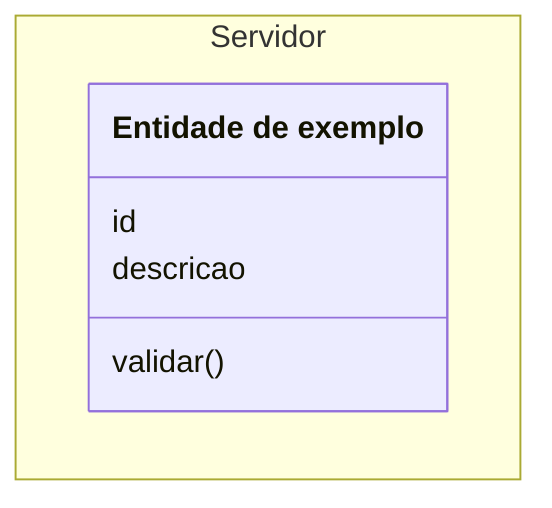
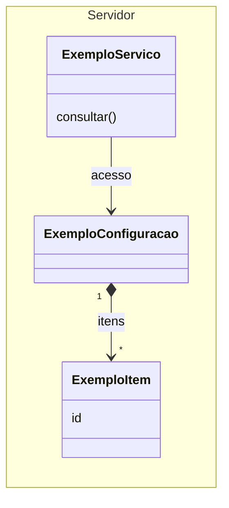

# Guia de edição do modelo DDD em Mermaid

A equipe mantém um único modelo, construído progressivamente a partir da base
apresentada pelo professor. Cada integrante pode propor os conceitos necessários
à sua feature e discutir sua integração com o restante do modelo.

## 1. Qual arquivo usar

| Arquivo | Uso |
| --- | --- |
| [modelo-ddd.mmd](modelo-ddd.mmd) | Fonte oficial do diagrama. Contém somente código Mermaid, incluindo configuração e comentários. |
| [GUIA-MERMAID.md](GUIA-MERMAID.md) | Este guia: instruções e exemplos isolados. |
| [ddd-notificacoes-incremental.png](ddd-notificacoes-incremental.png) | Imagem exportada para visualização rápida. |

Edite o `.mmd` para modificar o modelo. O PNG precisa ser atualizado depois das
mudanças aprovadas; editar a imagem não modifica o código. O arquivo `.mmd` pode
ser aberto em qualquer editor de texto. No GitHub, ele pode ser consultado como
texto; use o Mermaid Live para renderizar o código completo.

## 2. Abrir no Mermaid Live

1. Abra [Mermaid Live Editor](https://mermaid.live/).
2. Se aparecer uma oferta de outro produto, escolha **Stay on mermaid.live**.
3. Abra `modelo-ddd.mmd` no editor de texto ou no GitHub e copie todo o conteúdo.
4. No painel **Code** do Mermaid Live, selecione todo o exemplo inicial e
   substitua-o pelo conteúdo copiado.
5. Inclua o cabeçalho entre `---`, o `classDiagram` e todas as linhas seguintes.
   O arquivo já está pronto: não acrescente delimitadores Markdown como
   ` ```mermaid ` ou ` ``` `.
6. Confira o desenho no painel de visualização. Use os controles de zoom e
   **Reset view** para navegar pelo diagrama.

Alterar o código no Mermaid Live não atualiza o repositório automaticamente.
Depois de editar, copie todo o código de volta para `modelo-ddd.mmd` na sua branch.
Uma URL compartilhada do editor também não substitui o arquivo versionado no Git.

## 3. Entender as partes do arquivo

- O cabeçalho `config`, entre `---`, define aparência e espaçamento.
- `classDiagram` define o tipo de diagrama; `direction LR` organiza-o da
  esquerda para a direita.
- `namespace Cliente` reúne os módulos do cliente, como configuração e histórico.
- `namespace Servidor` reúne os objetos e serviços do servidor.
- As linhas depois das declarações representam as relações entre os elementos.
- `style` e `note` acrescentam destaques e anotações.
- Linhas iniciadas por `%%` são comentários e não criam relações no desenho.

Uma caixa escrita com `class` não é automaticamente uma entidade de DDD. Ela
pode representar um módulo, uma entidade, um objeto de valor, um serviço ou uma
coleção, conforme o conceito discutido pela equipe. Entidades precisam de
identidade e continuidade; objetos de valor são definidos por seus valores.

As associações indicam acesso ou referência. Elas não determinam a sequência de
requisições nem garantem que um cenário esteja implementado. As operações
representadas são conceituais: seus nomes não fixam endpoints ou tipos da aplicação.

Os comentários sobre propostas pendentes não significam que essas propostas
estejam aprovadas ou desenhadas. Uma decisão discutida precisa ser revisada
antes de entrar no modelo.

## 4. Adicionar uma classe, atributos e métodos

Este exemplo é independente e pode ser colado sozinho no Mermaid Live. Ele
ensina a sintaxe; não adiciona uma entidade real ao projeto.



- `ExemploEntidade` é o identificador usado nas relações. Escolha identificadores
  únicos, sem espaços; por exemplo, `MinhaEntidade` ou `MinhaEntidadeCliente`.
- O texto entre colchetes e aspas é o nome visível. Ele pode ter espaços e acentos.
- `id` e `descricao` são atributos; uma linha com parênteses, como `validar()`,
  representa uma operação.
- Para ampliar a classe, acrescente seus atributos e operações dentro das chaves.

Para incluir uma classe no modelo principal, copie somente sua declaração para
o `namespace` adequado que já existe no `.mmd`. Mantenha apenas um `classDiagram`
e o cabeçalho de configuração original. Evite declarar duas vezes o mesmo elemento.

## 5. Adicionar relações e cardinalidades

Este segundo exemplo também é independente. As classes são fictícias e servem
somente para demonstrar uma configuração com itens e um serviço com acesso a ela.



No modelo principal, declare os elementos primeiro e acrescente a relação na
seção de relações correspondente. Use seus identificadores, não seus nomes visíveis.

| Sintaxe | Significado |
| --- | --- |
| `A --> B` | Associação com navegação de A para B: A acessa ou referencia B. |
| `A -- B` | Ligação sem uma direção de navegação indicada. |
| `A *--> B` | Composição com navegação: B faz parte de A; o losango preenchido fica em A. |
| `A o--> B` | Agregação com navegação: A agrupa B; o losango vazio fica em A. |
| `A --> B : origem` | Associação com um rótulo que explica seu significado. |
| `A "1" --> "*" B` | Cada A associa-se a zero ou mais B; cada B associa-se a um A. |

As multiplicidades aparecem entre aspas junto aos extremos: `"1"` significa um,
`"0..1"` significa zero ou um, `"*"` significa zero ou mais e `"1..*"` significa
um ou mais. Escolha-as a partir das regras da feature, não da posição das caixas.

O modelo original também contém extremos combinados, como a relação entre
`Student` e `Enrolment`. Preserve sua notação enquanto a equipe não revisar seu
significado. Agregação na notação UML não é sinônimo de agregado em DDD: um agregado
DDD delimita objetos cujas regras de consistência precisam ser protegidas conjuntamente.

Antes de escolher composição, discuta o pertencimento e o ciclo de vida das
partes. Uma relação útil para acessar dados não exige necessariamente composição.

## 6. Ajustar o espaço sem alterar o modelo

O Mermaid calcula as posições. No cabeçalho existente:

- Aumente `nodeSpacing` para ampliar o espaço entre elementos.
- Aumente `rankSpacing` para ampliar o espaço entre camadas do desenho.
- Ajuste `fontSize` com cuidado para manter nomes e operações legíveis.

Faça ajustes pequenos e observe o resultado. Preserve a indentação do YAML e os
nomes das configurações. Para resolver falta de espaço, ajuste a apresentação;
qualquer remoção de relação precisa de uma justificativa conceitual própria.

## 7. Conferir a feature antes de propor a mudança

Escolha um cenário e verifique:

1. Quais informações ele exige e onde estão representadas ou serão obtidas.
2. Quais objetos ou serviços precisam acessar essas informações.
3. Quais relações e multiplicidades permitem esse acesso.
4. Quais regras e mudanças de estado precisam ser definidas.
5. Como representar o caso de sucesso e as rejeições ou falhas previstas.

Para um lembrete de notas pendentes, por exemplo, precisamos considerar o
agendamento, a turma, o professor destinatário, as pendências e o resultado do
processamento. Listar esses dados não aprova automaticamente novas classes:
primeiro discuta com a equipe como cada informação deve ser representada.

Um caminho de setas não prova que o cenário funciona. A análise do diagrama é
conceitual; os testes da futura implementação precisam comprovar suas regras.
Quando outra equipe ainda não disponibiliza uma dependência, combine seu contrato
e os dados necessários para um mock/stub. Não trate esse dado simulado como uma
funcionalidade já implementada no projeto.

## 8. Trabalhar em equipe com branches e PRs

Enquanto o modelo estiver na branch `docs/modelo-ddd-incremental`, crie sua branch
própria a partir dela. Depois de sua integração à `main`, use a `main` atualizada
como base. Cada integrante deve escolher um nome de branch exclusivo.

Exemplo para um clone cujo `origin` contém a branch compartilhada do DDD:

```sh
git fetch origin
git switch -c docs/ddd-minha-feature origin/docs/modelo-ddd-incremental
```

Edite e valide o `.mmd`, atualize o PNG quando o modelo mudar e registre os arquivos:

```sh
git add -- docs/arquitetura/modelo-ddd.mmd docs/arquitetura/ddd-notificacoes-incremental.png
git commit -m "docs: estende o modelo DDD para minha feature"
git push -u origin docs/ddd-minha-feature
```

Se editar o guia, inclua também `GUIA-MERMAID.md` no commit. Os comandos pressupõem
que você esteja na pasta do repositório e que possa publicar no seu `origin`.

Abra um PR para a branch que a equipe definiu como destino: neste estágio, a
branch compartilhada do DDD; depois de integrada, a `main`. No PR, explique o
conceito acrescentado, as relações e os cenários que motivam a proposta. Peça
revisão à equipe antes de integrar a alteração. O PR deve conter o código atualizado
e sua visualização, sem mudanças incidentais na aplicação.

Quando houver alterações concorrentes, compare as mudanças nas classes e nas
relações durante a resolução do conflito. Depois de resolvê-lo, abra o código final
novamente no Mermaid Live e exporte uma imagem que corresponda a ele.

## 9. Atualizar a imagem e revisar o resultado

1. Cole a versão final do `.mmd` no Mermaid Live e confira a renderização.
2. Abra **Actions**, escolha **PNG** e exporte a imagem.
3. Salve-a como `docs/arquitetura/ddd-notificacoes-incremental.png` no seu clone.
4. Confira se as novas caixas estão legíveis e se as relações esperadas aparecem.
5. Inclua a fonte e a imagem correspondente no mesmo PR.

O código é a fonte oficial. A exportação pode variar visualmente entre versões
do Mermaid; compare os conceitos e as relações, além da aparência.

Antes de concluir, confirme que o arquivo abre sem erro, que os novos identificadores
são únicos, que não surgiram caixas por erros de digitação nas relações e que a
base do professor permanece representada, salvo uma alteração justificada e revisada.

## Referências de sintaxe

- [Diagramas de classes Mermaid](https://mermaid.js.org/syntax/classDiagram.html).
- [Configuração e cabeçalho YAML](https://mermaid.js.org/config/configuration.html).
- [Mermaid Live Editor](https://mermaid.live/).
