# Modelo editável do Teaching Assistant

Este arquivo é a fonte em texto do modelo. A equipe pode editar o bloco Mermaid
abaixo em qualquer editor ou no GitHub. O GitHub mostra o desenho na visualização
do Markdown; PNG e SVG são cópias exportadas desse desenho.

O painel Cliente representa módulos. O painel Servidor representa os objetos
e serviços do modelo. A notação de caixas não significa que tudo já esteja
implementado na aplicação. Os nomes de operações são conceituais;
os parênteses permitem ao Mermaid desenhá-los como operações.

## Modelo completo

```mermaid
---
config:
  theme: base
  layout: dagre
  themeVariables:
    fontFamily: Arial
    fontSize: 22px
    primaryColor: '#f6faf7'
    primaryTextColor: '#182b35'
    primaryBorderColor: '#182b35'
    lineColor: '#182b35'
    secondaryColor: '#e4f8fa'
  class:
    theme: base
    look: classic
    nodeSpacing: 90
    rankSpacing: 140
    diagramPadding: 40
    textHeight: 32
    padding: 20
    dividerMargin: 12
    htmlLabels: false
    hideEmptyMembersBox: true
    useMaxWidth: false
---
classDiagram
direction LR

%% CLIENTE: módulos já validados.
namespace Cliente {
  class Application
  class Students
  class Goals
  class StudentService["Student Service"]
  class Email
  class ConfiguracaoLembretesCliente["Configuração de lembretes"]
  class HistoricoNotificacoesCliente["Histórico de notificações"]
  class EmailService["Email Service"]
}

class Interface["Interface (i)"]

%% SERVIDOR: base do professor e extensões validadas.
namespace Servidor {
  class Services {
    addStudent()
    removeStudent()
    synchronize()
    configurarLembretes()
    consultarHistorico()
    consultarDetalhesNotificacao()
  }
  class StudentListImport["StudentList Import"]
  class StudentList {
    add(Student)
    remove(Student)
  }
  class Student {
    name
    email
  }
  class GradesImportService["Grades Import Service"]
  class Classes
  class Class {
    semester
  }
  class Enrolment
  class Evaluation {
    goal
    grade
  }
  class GradeNotification["Grade Notification"]
  class EmailSender {
    send(String[])
  }
  class ConfiguracaoLembretes {
    add(Lembrete)
  }
  class Lembrete {
    data
    horário
    estado
  }
  class HistoricoNotificacoes
  class Notificacao
}

%% CLIENTE E INTERFACE: preserve as duas formas de acesso ao servidor.
Application --> Students
Application --> Goals
Students --> StudentService
Goals --> StudentService
StudentService --> Interface
Interface -- Services
Application --> Email
Email --> ConfiguracaoLembretesCliente
Email --> HistoricoNotificacoesCliente
ConfiguracaoLembretesCliente --> EmailService
HistoricoNotificacoesCliente --> EmailService
EmailService --> Interface

%% BASE DO SERVIDOR: relações do diagrama original.
Services --> StudentListImport
Services --> StudentList
Services --> GradesImportService
Services --> Classes
Services --> GradeNotification
StudentList *--> "*" Student
GradesImportService --> Classes
Classes *--> "*" Class
Class *--> "*" Enrolment
Student "1" *--o "*" Enrolment : enrolments / student
GradeNotification o--> "*" Enrolment
Enrolment *--> "*" Evaluation : auto-evaluations
Enrolment *--> "*" Evaluation : evaluations
GradeNotification --> EmailSender

%% EXTENSÕES JÁ VALIDADAS.
Class --> ConfiguracaoLembretes
ConfiguracaoLembretes *--> "*" Lembrete : lembretes
Services --> HistoricoNotificacoes

%% NOTIFICAÇÃO: objeto e ligações aprovados para este incremento.
HistoricoNotificacoes *--> "*" Notificacao
Notificacao --> Lembrete : origem

%% Os campos de Notificacao serão definidos em conjunto.
%% TentativaEnvio será modelada no próximo incremento.
%% PROPOSTA PENDENTE, ainda não desenhada: GradeNotification --> Lembrete.
%% A relação de GradeNotification com EmailSender já existe na base.

style Notificacao fill:#fff4cd,stroke:#93600c,stroke-width:2px
note for Services "configurarLembretes reúne quantidade, datas e horários."
```



## Como editar em equipe

1. Edite este arquivo em uma branch da equipe.
2. Acrescente ou altere as caixas nas seções Cliente ou Servidor.
3. Acrescente ou altere uma linha na seção de relações.
4. Confira o desenho no Preview do GitHub ou copie o conteúdo do bloco para
   [Mermaid Live Editor](https://mermaid.live/).
5. Abra um PR com uma explicação das relações e dos cenários que motivaram a mudança.
6. Depois da revisão, exporte SVG/PNG pelo editor e atualize as cópias do desenho.

Para adicionar um método, basta alterar o corpo da caixa, por exemplo:

```text
class ConfiguracaoLembretes {
  add(Lembrete)
}
```

Para ligar dois objetos, use uma linha como:

```text
Notificacao --> Lembrete : origem
```

As setas usadas neste modelo:

| Código | Significado |
| --- | --- |
| `A --> B` | Associação: A acessa ou referencia B. |
| `A -- B` | Ligação sem indicar uma direção de navegação. |
| `A *--> B` | Composição, com acesso a B. |
| `A o--> B` | Agregação, com acesso a B. |
| `A "1" *--o "*" B` | Relação com os dois tipos de extremo e as cardinalidades, como Student/Enrolment na base. |

O Mermaid calcula as posições. Para aumentar o espaço, ajuste `nodeSpacing` e
`rankSpacing` no início do bloco. Campos, cardinalidades e relações novas devem
ser discutidos com a equipe antes de serem tratados como decisões do modelo.

Os nomes compactos em Services correspondem às responsabilidades já validadas:

| Nome no desenho | Responsabilidade |
| --- | --- |
| `configurarLembretes()` | Configurar quantidade, datas e horários dos lembretes. |
| `consultarHistorico()` | Consultar histórico de notificações. |
| `consultarDetalhesNotificacao()` | Consultar detalhes de uma notificação. |

Esses nomes não definem os parâmetros, os tipos ou os endpoints da futura aplicação.

Referências de uso: [diagrama de classes Mermaid](https://mermaid.js.org/syntax/classDiagram.html)
e [diagramas no GitHub](https://docs.github.com/en/get-started/writing-on-github/working-with-advanced-formatting/creating-diagrams).
